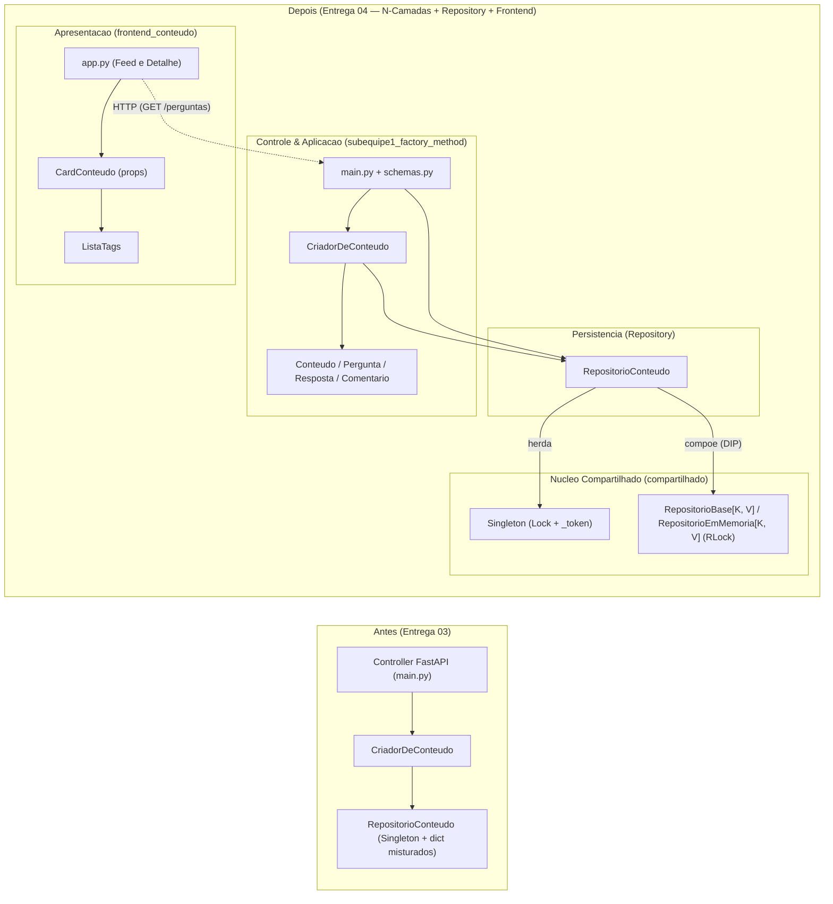

# Reutilização de Software
O relatório deverá conter a estrutura de focos estabelecida a seguir, bem como versionamentos, metodologia e participantes por foco.
Não omitir tópicos.

## Focos do Relatório:
### FOCO_01: Reutilização de Software
Entrega Mínima: Evidência de Reutilização (ex. Components do React documentados e demonstrados em uso).
Se todos os itens forem atendidos, garante-se 1 ponto na média. 
Caso parte da entrega mínima seja negligenciada, essa pontuação é reduzida, conforme insumos de entrega. 
Quem não entrega, não recebe pontuação alguma.

### Participantes no Foco_01
| Nome do Membro |
|---|
| Caio Soares |
### Metodologia do Foco_01

#### Como a SubEquipe 01 organizou o trabalho

Partimos de um fluxo que já funcionava na Entrega 03: publicar uma pergunta e consultá-la em outra requisição. Ao percorrer esse fluxo, identificamos duas oportunidades de reuso. No backend, o mesmo repositório controlava a instância única e guardava os dados. Na apresentação, pergunta, resposta e comentário compartilhavam autor, corpo e data, mas o painel de validação exibia esses dados de maneiras diferentes. Usamos esses dois casos para definir o que extrair e onde demonstrar o primeiro uso de cada componente. [Escopo e código de partida da #15][i15]

Dividimos o trabalho por fluxo de uso. Caio ficou responsável por **armazenar e exibir conteúdo**, da extração do repositório até o feed e o detalhe. Maria Laura ficou responsável por **publicar e integrar conteúdo**, com os contratos de leitura e escrita, o serviço, o adaptador para Ads e os formulários. Cada integrante recebeu uma issue pai e tarefas de backend, frontend e documentação. Para trabalhar em paralelo, a dupla combinou a assinatura de `listar_perguntas()` e os métodos legados que os criadores continuariam usando. Isso permitia escrever o contrato de leitura enquanto o armazenamento era refatorado. A ordem de integração acordada foi #17 → #18 → #22. [Divisão da dupla e acordo sobre os contratos][acordo]

#### Reuniões da dupla

Caio e Maria Laura se reuniram nas três últimas quartas-feiras antes da entrega para alinhar o escopo e definir as issues de cada integrante. As reuniões não tiveram ata. O resultado de cada uma ficou registrado nas issues abertas logo depois e no comentário de alinhamento da #20.

| Data | Participantes | Pauta | Registro |
|---|---|---|---|
| 04/11/2026 (quarta) | Caio Soares e Maria Laura Regis | Alinhamento do escopo da Entrega 04 no subdomínio de Conteúdo e escolha das oportunidades de reuso | Escopo descrito nas issues pai [#15][i15] e [#20](https://github.com/UnBArqDsw2026-2-Turma02/2026.2-T02-_G2_ProjetoForum_Entrega04/issues/20) |
| 11/11/2026 (quarta) | Caio Soares e Maria Laura Regis | Definição das issues de armazenamento e exibição de conteúdo | [#15][i15] a [#19][i19], abertas em 16/11/2026 |
| 18/11/2026 (quarta) | Caio Soares e Maria Laura Regis | Definição das issues de publicação e integração de conteúdo e acordo sobre os contratos compartilhados | [#20](https://github.com/UnBArqDsw2026-2-Turma02/2026.2-T02-_G2_ProjetoForum_Entrega04/issues/20) a [#24][i24], abertas em 19/11/2026, e [comentário de alinhamento][acordo] |

#### Como construímos e verificamos o reuso

1. **Extraímos o mecanismo de persistência.** Separamos a criação de uma instância por processo, em `Singleton`, das operações por chave, em `RepositorioBase[K, V]` e `RepositorioEmMemoria[K, V]`. O armazenamento genérico protege cada operação com `RLock`. Isolamos essa extração no commit local `009bd30` para que o contrato pudesse ser revisado antes da mudança em Conteúdo. [Extração do núcleo compartilhado — #17][i17]
2. **Aplicamos o componente a um consumidor existente.** No commit `8cee2f1`, `RepositorioConteudo` passou a compor o armazenamento com UUID como chave e `Conteudo` como valor. Preservamos os métodos usados pelos criadores e a propriedade `_conteudos` usada pela suíte herdada. Para alimentar o feed, a listagem percorre os produtos e chama `como_pergunta()`: a pergunta devolve a si própria e os demais conteúdos devolvem `None`. [Refatoração e critérios de compatibilidade — #18][i18]
3. **Ligamos a leitura às telas.** Acrescentamos `GET /perguntas` para o feed e usamos a consulta por ID já existente no detalhe. O primeiro commit entregou a rota (`9c542d7`) e o seguinte, as telas (`8f2b065`). Ao abrir uma conversa, o mesmo `CardConteudo` recebe os dados da pergunta, de cada resposta e de cada comentário. As *props* controlam o título clicável, as tags, o status e o destaque de resposta aceita. A revisão visual e a busca entraram depois, em `56953cf`. Na versão demonstrada, a rota consulta o repositório injetado pelo FastAPI. A conexão pelo serviço e a composição com os formulários estão previstas nas tarefas da dupla. [Componentes de exibição — #19][i19] · [Camada de serviço — #22][i22] · [Formulários — #24][i24]
4. **Verificamos a compatibilidade e o uso de ponta a ponta.** Rodamos a suíte existente a partir de `codigo/` com `python -m pytest -q`: os 212 testes passaram. Para conferir o que o usuário vê, publicamos uma pergunta com tags, uma resposta e um comentário pela API. No navegador, verificamos a busca, a abertura da conversa pelo título, a exibição dos três conteúdos e o retorno ao feed em largura móvel. Esse percurso também orienta a apresentação da SubEquipe 01. [Critérios de documentação — #16][i16] · [Roteiro de demonstração](roteiro_reutilizacao_conteudo.md)

[i15]: https://github.com/UnBArqDsw2026-2-Turma02/2026.2-T02-_G2_ProjetoForum_Entrega04/issues/15
[i16]: https://github.com/UnBArqDsw2026-2-Turma02/2026.2-T02-_G2_ProjetoForum_Entrega04/issues/16
[i17]: https://github.com/UnBArqDsw2026-2-Turma02/2026.2-T02-_G2_ProjetoForum_Entrega04/issues/17
[i18]: https://github.com/UnBArqDsw2026-2-Turma02/2026.2-T02-_G2_ProjetoForum_Entrega04/issues/18
[i19]: https://github.com/UnBArqDsw2026-2-Turma02/2026.2-T02-_G2_ProjetoForum_Entrega04/issues/19
[i22]: https://github.com/UnBArqDsw2026-2-Turma02/2026.2-T02-_G2_ProjetoForum_Entrega04/issues/22
[i24]: https://github.com/UnBArqDsw2026-2-Turma02/2026.2-T02-_G2_ProjetoForum_Entrega04/issues/24
[acordo]: https://github.com/UnBArqDsw2026-2-Turma02/2026.2-T02-_G2_ProjetoForum_Entrega04/issues/20#issuecomment-7013106686

### Reutilização de Software
Organizar as subseções de acordo com a necessidade de demonstração do nível de reutlização.
Deve-se revelar não apenas detalhes teóricos, mas também o uso.
#### SubEquipe 01 — Conteúdo

Na Entrega 01, a equipe priorizou reusabilidade e manutenibilidade. A Entrega 02 modelou pergunta e resposta como especializações de conteúdo e separou apresentação, controle e modelo. Na Entrega 03, o Factory Method passou a criar os produtos e o repositório passou a controlar a instância única. Na Entrega 04, a extração do armazenamento permite reutilizar essas decisões no feed. [Issue de documentação](https://github.com/UnBArqDsw2026-2-Turma02/2026.2-T02-_G2_ProjetoForum_Entrega04/issues/16)

| Nível de reutilização | Evidência no subdomínio |
|---|---|
| Abstração | O contrato genérico Repository define operações por chave. O Factory Method define o contrato de criação e publicação dos três produtos. |
| Objeto | Os criadores recebem a mesma instância de `RepositorioConteudo` por processo. Cada pergunta agrega suas respostas e comentários. |
| Componente | O repositório de Conteúdo compõe o armazenamento genérico. Feed e detalhe usam `CardConteudo` e `ListaTags`. |
| Sistema | O frontend Streamlit e o painel de validação consomem a mesma API por HTTP. Uma publicação feita pelo painel pode ser lida pelo feed. |

**Camadas e princípios.** As telas de apresentação consultam os controllers e DTOs FastAPI. Na aplicação, os criadores executam a publicação. O domínio reúne os produtos e suas relações. Na infraestrutura, o Singleton gerencia o ciclo de vida e o armazenamento genérico protege as operações de dicionário com `RLock` (SRP). O repositório de Conteúdo usa o contrato `RepositorioBase` para persistir e consultar dados (DIP). A listagem chama `como_pergunta()` em qualquer produto. O card exibe os atributos comuns dos três produtos e recebe por parâmetros os detalhes de apresentação (LSP). A integração da camada de serviço com os controllers pertence à #22. [Divisão da dupla](https://github.com/UnBArqDsw2026-2-Turma02/2026.2-T02-_G2_ProjetoForum_Entrega04/issues/20#issuecomment-7013106686)

**Parametrização dos componentes de exibição (*props*).** O mesmo componente `CardConteudo` ([`componentes.py`](../../../codigo/frontend_conteudo/componentes.py)) e o subcomponente `ListaTags` são reutilizados nas duas telas de [`app.py`](../../../codigo/frontend_conteudo/app.py), variando apenas os argumentos recebidos:

| Contexto de uso | `variante` | `mostrar_tags` | `mostrar_status` | `destaque_aceita` | `link_detalhe` | Efeito visual |
|---|---|---|---|---|---|---|
| **Feed** (listagem de perguntas) | `"pergunta"` | `True` | `True` | `False` | `True` | Título clicável para o detalhe, `ListaTags`, status e rodapé com contadores |
| **Detalhe — Pergunta** | `"pergunta"` | `True` | `True` | `False` | `False` | Título estático completo, corpo, `ListaTags` e selo de status |
| **Detalhe — Resposta** | `"resposta"` | `False` | `False` | `True` | `False` | Card sem título/tags e selo `"Resposta aceita"` quando `item.aceita` for verdadeiro |
| **Detalhe — Comentário** | `"comentario"` | `False` | `False` | `False` | `False` | Apresentação compacta exibindo autor, data formatada e corpo |

**Demonstração.** Inicie a API e o frontend conforme o README. Publique uma pergunta com tags, uma resposta e um comentário pela API. Abra o feed em uma nova sessão, selecione a pergunta e confira o autor e o corpo nos três cards. As tags aparecem tanto no feed quanto no detalhe. O armazenamento dura até o encerramento do processo da API. [Execução local](../../../codigo/README.md#feed-e-detalhe-de-conteúdo)

### Vídeo Demonstrando o Uso
O vídeo mostra o subdomínio de Conteúdo em execução. Uma pergunta, uma resposta e um comentário são publicados pelo Swagger (`201 Created`) e depois aparecem no feed, na busca por tag e no detalhe. Após cada passo, aparece o trecho de código usado: os criadores do Factory Method, o `RepositorioConteudo` com o `Singleton` e o `RepositorioEmMemoria`, e o `CardConteudo` reutilizado nos três contextos por meio de *props*. O percurso segue o [roteiro de demonstração](roteiro_reutilizacao_conteudo.md).

<iframe width="720" height="405" src="https://www.youtube.com/embed/8p4TfRxMUuo" title="Demonstração da reutilização no subdomínio Conteúdo" frameborder="0" allow="accelerometer; clipboard-write; encrypted-media; gyroscope; picture-in-picture" allowfullscreen></iframe>

[Assistir no YouTube](https://youtu.be/8p4TfRxMUuo)

#
### FOCO_02: IA Generativa
Entrega Mínima: pontos de vista de cada membro da equipe sobre as lições aprendidas e uso da IA Generativa.
TODOS DEVEM PARTICIPAR!
### Participantes no Foco_02
| Nome do Membro | Lições Aprendidas | Uso da IA Generativa (SENSO CRÍTICO) |
|---|---|---|
| Caio Soares | Aprendi na prática a separar responsabilidades de infraestrutura aplicando **SRP** e **DIP**: extrair o controle de instância única (`Singleton`) do armazenamento em memória (`RepositorioEmMemoria[K, V]`) via contrato `RepositorioBase` permitiu reutilizar a persistência sem quebrar a API pública nem a propriedade legada `_conteudos` (mantendo todos os 212 testes existentes verdes). Também vi como o polimorfismo (`como_pergunta()`) sustenta o **LSP** tanto na filtragem do repositório quanto na camada de apresentação, onde o mesmo componente `CardConteudo` exibe `Pergunta`, `Resposta` e `Comentario` apenas alterando *props* sem duplicar código nem usar Jinja2. | Utilizei a IA generativa como apoio na extração dos componentes genéricos (`Singleton` e `RepositorioEmMemoria`), na organização da camada de apresentação Streamlit com CSS customizado (`forum.css`) e na estruturação da documentação/roteiro. Todas as sugestões foram validadas criticamente com a suíte `pytest` herdada (212 testes passando) e com testes manuais ponta a ponta no navegador. Em um dos testes visuais após ampliar a assinatura de `CardConteudo` com a *prop* `link_detalhe` (`56953cf`), o navegador exibiu erro porque o processo Streamlit em execução mantinha a assinatura anterior em memória; foi necessário reiniciar o servidor do frontend e revalidar busca, navegação para o detalhe, atualização de comentário ao vivo e responsividade em largura móvel. |

#
## Versionamentos

| Membro | Contribuição | Data |
|---|---|---|
| Caio Soares | Persistência reutilizável (#17, #18), listagem e apresentação (#19). Commits locais `009bd30`, `8cee2f1`, `9c542d7` e `8f2b065`. | 19/11/2026 |
| Caio Soares | Metodologia do Foco 01 com divisão da dupla, sequência de implementação e verificação do reuso, conforme as issues da SubEquipe 01. | 19/11/2026 |
| Caio Soares | Revisão visual do feed com busca (`56953cf`), roteiro de apresentação (`05eb50d`), diagrama N-Camadas/Repository, tabela de *props* de `CardConteudo` e relato crítico do Foco 02 (#16). | 21/11/2026 |
| Caio Soares | Vídeo de demonstração do uso, com publicações pela API e o código reutilizado em cada passo, e registro da ausência de iniciativas extras. | 22/11/2026 |
| Caio Soares | Registro das três reuniões da dupla (04/11, 11/11 e 18/11) que definiram as issues da SubEquipe 01. | 22/11/2026 |
OBS: TODOS DEVEM PARTICIPAR, MOSTRANDO SEUS PONTOS DE VISTA E COMO COLABORARAM NA ENTREGA.

--
# Observações: 
Entregável: Relatório, documentado no GitPages, revelando:
## Entrega Mínima COM DAS: DAS com Visão Lógica e mais uma visão (à escolha), com evidência de algo rodando (ex. um conjunto de features), e pontos de vista de cada membro da equipe sobre as lições aprendidas e uso da IA Generativa. Se todos os itens forem atendidos, garante-se 1 ponto na média. Caso parte da entrega mínima seja negligenciada, essa pontuação é reduzida, conforme insumos de entrega. Quem não entrega, não recebe pontuação alguma.

OU
## Entrega Mínima COM REUTILIZAÇÃO: Evidência de Reutilização (ex. Components do React documentados e demonstrados em uso) e pontos de vista de cada membro da equipe sobre as lições aprendidas e uso da IA Generativa. Se todos os itens forem atendidos, garante-se 1 ponto na média. Caso parte da entrega mínima seja negligenciada, essa pontuação é reduzida, conforme insumos de entrega. Quem não entrega, não recebe pontuação alguma.

## 📌A ideia não é quantidade, e sim qualidade do que é entregue.

## Apresentação:
Apresentação (para a professora) explicando o artefato elaborado, com: (i) rastro claro aos membros participantes (MOSTRAR QUADRO DE PARTICIPAÇÕES & COMMITS); (ii) justificativas & senso crítico sobre o trabalho realizado, e (iii) comentários gerais sobre o trabalho em equipe. Tempo da Apresentação: +/- 10min. Recomendação: Apresentar diretamente via Wiki ou GitPages do Projeto. Baixar os conteúdos com antecedência, evitando problemas de internet no momento de exposição nas Dinâmicas de Avaliação.

A Wiki ou GitPages do Projeto deve conter um tópico dedicado ao relatório com a entrega mínima, versionamentos, referências, e demais detalhamentos gerados pela equipe nesse escopo.
Demais orientações disponíveis nas Diretrizes (vide Aprender3).
